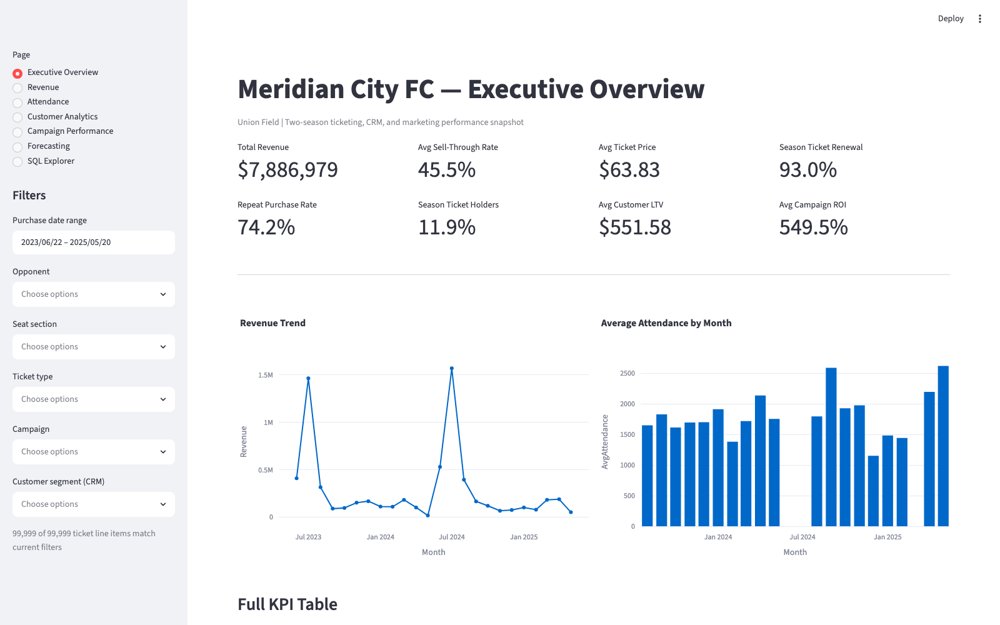
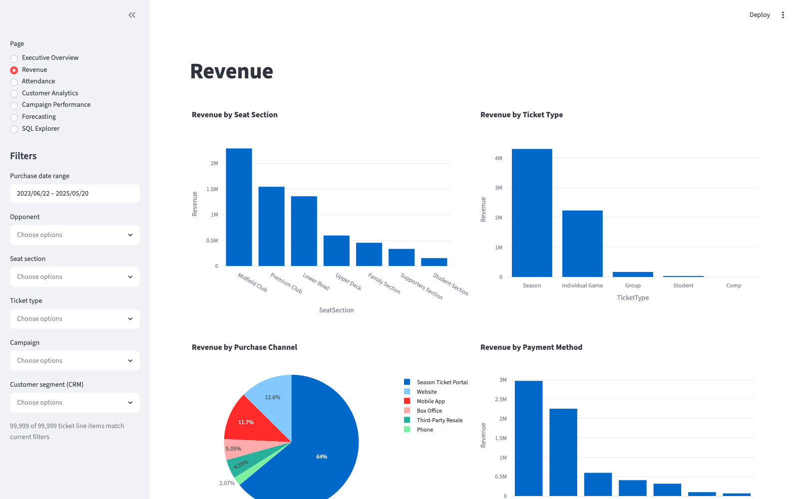
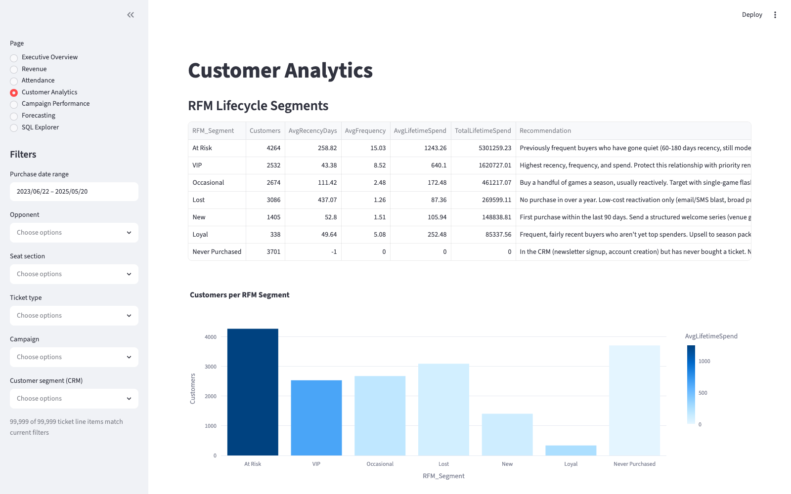
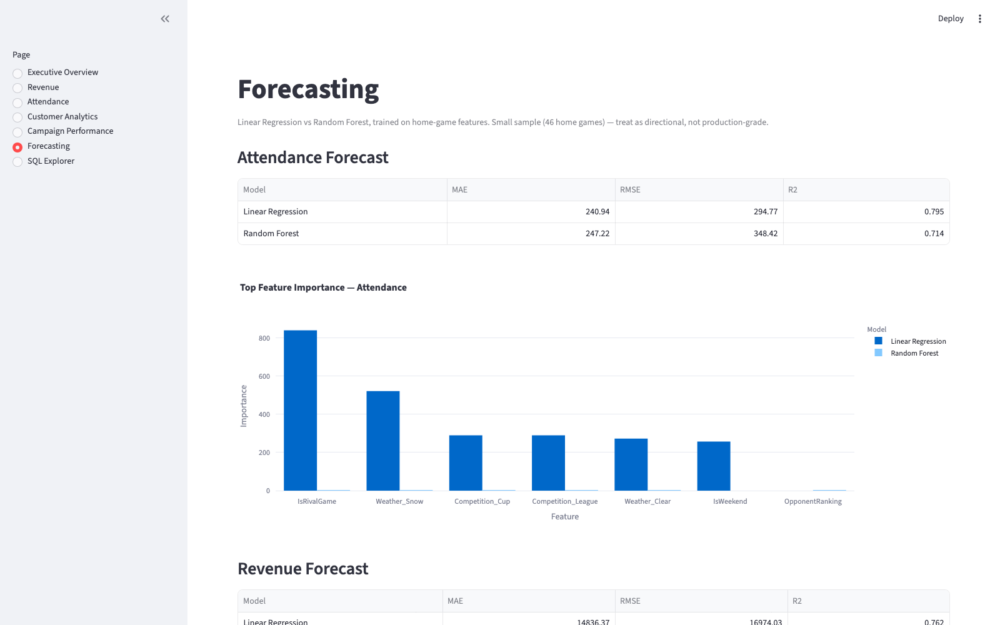

# Meridian City FC — Sports Business Intelligence Platform

A BI system for a professional soccer club's ticketing, CRM, and marketing data. It covers
the whole loop: raw data in, a warehouse, a query layer, and a dashboard the front office
can actually open on a Monday morning.



## Business problem

Every club front office ends up asking the same handful of questions each season. Are we
selling through our inventory or not? Which fans are worth protecting, and which ones are
already drifting away? Is the marketing spend doing anything, or is half of it just noise?
Can we get close enough on attendance and revenue forecasts to plan staffing and pricing
ahead of a fixture instead of reacting to it?

This project is my attempt at building what a BI analyst on a club's business ops team
would actually own to answer those: a warehouse, a query layer, a segmentation and
forecasting layer, and a dashboard on top of all of it.

## Architecture

```
Raw CSV (etl/generate_data.py)
        |
        v
Validation (etl/validate.py)  ---->  reports/data_quality_report.md
        |
        v
Cleaning (etl/clean.py)              data/cleaned/*.csv
        |
        v
Transformation (etl/transform.py)    data/processed/*.csv
        |
        v
Load (etl/load_database.py)          database/ticket_sales.db (SQLite via SQLAlchemy)
        |
        +---> sql/business_queries.sql   (39 analytical queries)
        +---> analytics/segmentation.py  (RFM lifecycle segmentation)
        +---> analytics/forecasting.py   (Linear Regression vs Random Forest)
        +---> analytics/kpi_calculations.py (executive KPI engine)
        |
        v
dashboard/app.py (Streamlit, 7 pages, cross-filtered)
```

Each stage is its own runnable module, and all of them read from one
[`config/config.yaml`](config/config.yaml) for the business constants: stadium capacity,
season dates, seat pricing, rival opponents. I didn't want capacity numbers or pricing
logic hardcoded in three different files, so if you want to model a different stadium
size or season structure, that's the only file you touch.

To run it:

```bash
python -m venv .venv && source .venv/bin/activate
pip install -r requirements.txt
python -m etl.run_pipeline          # generate -> validate -> clean -> transform -> load
streamlit run dashboard/app.py
```

If you've already got raw data and just want to rerun cleaning/loading, use
`python -m etl.run_pipeline --skip-generate`.

## Data pipeline

[`etl/generate_data.py`](etl/generate_data.py) builds a synthetic dataset: about 100,000
ticket sales across two seasons, 18,000 customers, 84 fixtures, 14 marketing campaigns,
and roughly 40,000 merchandise transactions. I didn't want this to be uniform random
noise, so a lot of the generation logic is about encoding actual stadium behavior:

- Season ticket holders show up to nearly every home game, and they renew at a modeled
  93% rate season over season, with real churn built in rather than a flat constant.
- Rival fixtures, weekend kickoffs, promotion nights, win streaks, and holiday windows all
  push a game's fill rate up; rain and snow push it back down.
- Seat sections respect their actual physical capacity per game. Season ticket holders
  skew heavily toward Premium and Midfield seating, but that preference can't oversell a
  section past its share of the stadium (see `_enforce_section_capacity` in
  `etl/generate_data.py` — this was a real bug I caught partway through and had to fix).
- Pricing follows real discounting logic: student, group, and season discounts, campaign
  attribution discounts, channel fees, and a demand surge on rival and cup fixtures.

Once the clean version exists, the same script reintroduces the kind of mess a real
ticketing extract would have: duplicate rows, missing values, malformed ZIP codes,
inconsistent capitalization, mixed date formats, sign-flipped negative prices. Otherwise
`validate.py` and `clean.py` would have nothing to actually do.

| Stage | Module | What it does |
|---|---|---|
| Validate | `etl/validate.py` | Read-only checks: missing values, duplicates, referential integrity, malformed ZIPs, negative prices, impossible dates. Writes `reports/data_quality_report.md`. |
| Clean | `etl/clean.py` | De-duplication, text standardization, date parsing, ZIP validation, price-sign correction, FK enforcement. |
| Transform | `etl/transform.py` | Recomputes true customer `LifetimeSpend` from actual transactions instead of trusting the stale CRM-reported figure, builds RFM inputs, derives game-level flags like `IsWeekend`, `IsHoliday`, `SellThroughRate`. |
| Load | `etl/load_database.py` | Builds the SQLAlchemy schema and bulk-loads all five tables in FK-safe order. |

## Database design

Five normalized tables (`sql/schema.sql`, mirrored as SQLAlchemy models in
`etl/models.py`), with primary keys, foreign keys, indexes, and check constraints:

- **customers** — the CRM dimension. Keeps both the CRM-reported lifetime spend and the
  transaction-derived true figure side by side, because in a real club those two numbers
  are never quite the same and that gap is itself useful information.
- **marketing_campaigns** — campaign calendar with type, cost, discount depth, target
  audience.
- **games** — two-season fixture schedule, home and away, with weather, attendance,
  capacity, and derived demand flags.
- **ticket_sales** — the fact table. One row per sold seat, tied back to customer, game,
  and (when applicable) campaign.
- **merchandise** — per-visit concession and merch spend, tied to customer and game.

## SQL analysis

[`sql/business_queries.sql`](sql/business_queries.sql) has 39 queries grouped by business
domain (revenue, attendance, retention, campaigns), and it leans on the stuff that's
actually useful in this kind of analysis: joins, CTEs, CASE logic, and window functions —
`ROW_NUMBER`, `RANK`, `LAG`, running totals, `PARTITION BY`. I ran all 39 against the live
database while building this, not just once at the end. One example:

```sql
-- Season ticket renewal rate: STH active in season 1 who also bought in season 2
WITH season1_sth AS (
    SELECT DISTINCT t.CustomerID
    FROM ticket_sales t INNER JOIN games g ON g.GameID = t.GameID
    WHERE g.Season = '2023-24' AND t.TicketType = 'Season'
),
season2_buyers AS (
    SELECT DISTINCT t.CustomerID
    FROM ticket_sales t INNER JOIN games g ON g.GameID = t.GameID
    WHERE g.Season = '2024-25' AND t.TicketType = 'Season'
)
SELECT
    COUNT(*) AS Season1SeasonTicketHolders,
    SUM(CASE WHEN s2.CustomerID IS NOT NULL THEN 1 ELSE 0 END) AS RenewedInSeason2,
    ROUND(100.0 * SUM(CASE WHEN s2.CustomerID IS NOT NULL THEN 1 ELSE 0 END) / COUNT(*), 2) AS RenewalRatePct
FROM season1_sth s1
LEFT JOIN season2_buyers s2 ON s2.CustomerID = s1.CustomerID;
```

The dashboard's SQL Explorer page lets you run any of these 39 as presets, or write your
own `SELECT`/`WITH` query straight against the warehouse.

## Exploratory data analysis

[`notebooks/exploratory_analysis.ipynb`](notebooks/exploratory_analysis.ipynb) covers the
usual first pass: distributions, a correlation heatmap of what actually drives
attendance, monthly revenue and attendance trends, demographics, seat popularity, and
promotion effectiveness. Fully run, outputs committed, nothing stripped out.

## Machine learning

**Customer segmentation** (`analytics/segmentation.py`) does RFM scoring, Recency,
Frequency, Monetary, on quintiles, and maps the combination to six lifecycle segments:
VIP, Loyal, Occasional, New, At Risk, Lost, plus a separate "Never Purchased" bucket for
CRM contacts who signed up but never bought a ticket. Each segment comes with an actual
marketing recommendation written into the code, not just a label sitting in a table.

**Forecasting** (`analytics/forecasting.py`) compares Linear Regression against Random
Forest on per-game Attendance and Revenue, using schedule, weather, and rivalry features,
scored on MAE/RMSE/R². Right now Linear Regression wins on Attendance (R² 0.80 vs 0.71),
and Random Forest edges ahead on Revenue (R² 0.80 vs 0.76). I'm not going to pretend one
model is the clear winner here, because with only 46 home games to train on, neither
result means much beyond "directionally useful." Exact numbers for whatever data build
you generate live in `reports/forecasting_report.md`. What does hold up across both
models and both targets is which features matter: rivalry, weather (snow especially), and
whether it's a cup or league fixture.

**Executive KPI engine** (`analytics/kpi_calculations.py`) computes the standard slate:
total revenue, sell-through rate, average ticket price, average spend per fan, repeat
purchase rate, season ticket holder percentage, revenue per match and per customer,
campaign ROI, customer lifetime value, and season ticket renewal rate. All of it reads
straight from warehouse tables, so the dashboard and any one-off reporting script use the
exact same logic.

## Dashboard

`streamlit run dashboard/app.py` gets you 7 pages, all cross-filtered by date range,
opponent, seat section, ticket type, campaign, and CRM customer segment:

| Page | Contents |
|---|---|
| Executive Overview | KPI cards, revenue/attendance trend lines, full KPI table |
| Revenue | Revenue by seat section/ticket type/channel/payment method, top customers |
| Attendance | Day-of-week, weather, promotion, rivalry effects; sell-through scatter; game log |
| Customer Analytics | RFM segment table + chart, demographics, US-state choropleth map, top ZIP codes |
| Campaign Performance | Campaign ROI, cost vs. attributed revenue by channel, discount-vs-volume |
| Forecasting | Live Linear Regression vs. Random Forest comparison with feature importance |
| SQL Explorer | Run any of the 39 preset queries, or custom read-only SQL, against the warehouse |





## Business insights

Full write-up is in [`reports/executive_summary.md`](reports/executive_summary.md).
Every number in it comes from a query you can rerun yourself, nothing was picked to make
a nicer-sounding bullet point. A few of the ones that stood out to me:

- Weekend matches draw 15.2% more people than weekday fixtures.
- Premium seating (Premium Club + Midfield Club) brings in 57.0% of ticket revenue from
  just 38.4% of tickets sold.
- Rain cuts attendance by 27.9%. Rival games, on the other hand, boost it by 60.9%, which
  makes rivalry the single strongest demand driver in the whole dataset.
- Season ticket holders are only 11.9% of the customer base but account for 64.2% of
  ticket revenue, and they renew at 93.0% season over season.
- Email is, by a wide margin, the best-performing marketing channel: $238K in attributed
  revenue versus $114K for the next channel, Direct Mail.
- Student promotions cut average price by 77.2% and still fill seats that would otherwise
  sit empty.

## Testing

`tests/test_warehouse_integrity.py` runs sanity checks against whatever's currently
loaded: referential integrity, no negative monetary values, attendance never exceeding
capacity, seat sections never oversold per game, primary keys actually unique. Run with:

```bash
pytest tests/
```

## Repository structure

```
sports-business-intelligence/
├── config/               # config.yaml + loader for business constants
├── data/{raw,cleaned,processed}/
├── sql/                  # schema.sql, business_queries.sql (39 queries)
├── database/             # ticket_sales.db (SQLite)
├── notebooks/            # exploratory_analysis.ipynb
├── etl/                  # generate_data, validate, clean, transform, load_database, models, run_pipeline
├── analytics/            # segmentation (RFM), forecasting (ML), kpi_calculations
├── dashboard/            # app.py (Streamlit, 7 pages)
├── reports/              # data_quality_report.md, forecasting_report.md, executive_summary.md
├── screenshots/          # dashboard captures
└── tests/                # warehouse integrity tests
```

## What I'd add next

- Dynamic pricing: feed the forecasting output into an actual per-game price
  recommendation instead of static seat-section pricing.
- Real geocoding: swap the state-level choropleth for ZIP-level heat mapping once there's
  a reason to look at local market detail.
- A proper time-series model (Prophet or similar) once there's more than two seasons of
  history to work with. 46 home games isn't enough to pull apart seasonality.
- Incremental loads. Right now `load_database.py` truncates and reloads everything, which
  is fine for a rebuild but not how you'd want to handle new games coming in weekly.
- Real gate-scanner data instead of simulated `Scanned`/`Attended` flags, so the
  attendance dashboard could actually be live on game day.
